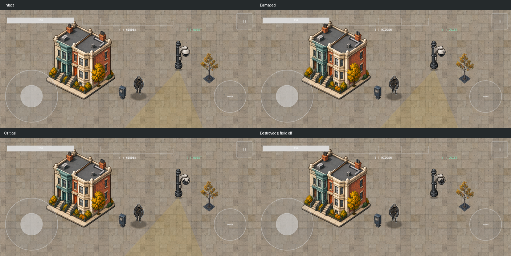

# Municipal camera settled-state study — CAPTURED candidate

Four physical conditions of the same municipal design: intact, damaged, critical and destroyed. The generated source is preserved in source.png; prompt.txt records the exact built-in image_gen prompt. Deterministic alpha cleanup and registration follow the user's authorization. export_camera_states.py in the review bundle reproduces the exports from that source.

Each frame uses a 256×384 texture, 64×96 logical canvas and (32,88) ground anchor. The same global scale is used across states; per-cell translations align the measured base center. Registration records include original cells, source anchor coordinates, hashes and cleanup mapping. Inspection confirms a non-emissive destroyed image and physical breaks that do not depend solely on color.

The permanent pole/base is not yet pixel-identical: compared with intact, lower-pole/base alpha masks differ at 67, 29 and 27 pixels in damaged, critical and destroyed states, respectively, on the 4× delivery canvas. These are measured differences, not a claim of visible jitter tolerance or final approval. Native-size overlay review and stable permanent structure still require completion.

The DEBUG benchmark fixture selects these four textures by supplied snapshot integrity through the actual WorldRenderer. The real scene, HUD and field geometry are captured for integrity 3→2→1→0. The capture asserts texture selection, unchanged node position and absence of the legacy housing node. These are individually rendered states, not an authoritative combat run or transition animation. The destroyed capture visibly has no field; existing CameraPlaybackTests separately test event-driven field removal and interruption using current production art.

The six required clip deliveries remain incomplete: four operational frames, two hit frames, three critical-entry frames, four destruction frames, one field-off frame and two destroyed-idle frames. These four stills do not fulfill those sixteen slots, and no production catalog or shipping asset admission changed. Persistent non-color notches and Captain distinction still need visual evidence. No physical-device test occurred.

Source study and test assets are review-only. Building footprint alignment, ground quality, player animation and performance remain open independently.

Validation: 83 iOS Swift Testing tests / 13 suites passed in 38.402 seconds, plus three XCTest checks. Four targeted core contract/catalog tests passed. Xcode result Test-SSRuntime-2026.10.14_10-51-37--0700.xcresult, iPhone 17 Pro iOS 26.5 simulator CACB3927-A76E-43A5-9ACA-C389EB38C0C3. Spec pin 262f4d66ddb271f5d4199be4ccfa130325f62221. Runtime base 4a63e77 plus the fixture changes in the commit containing this record. Original attachments remain in capture-clean/.

Reproduce exports: `python3 export_camera_states.py /absolute/path/to/source.png /absolute/path/to/export-directory`.
