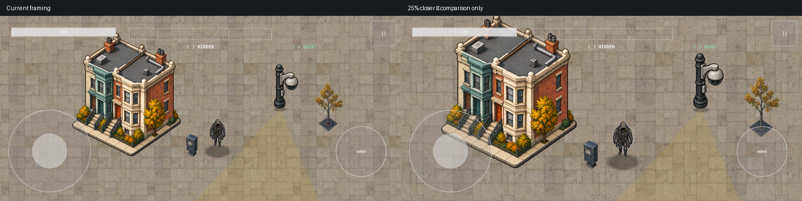

# Framing comparison — CAPTURED, not adopted

The same paused snapshot, candidate assets, world sizes, center and HUD are rendered at current framing and 1.25× world magnification. SpriteKit renders transformed world nodes before rasterization; this is not a resized screenshot. The transform is equivalent to camera scale 0.8 for this static capture. Shipping camera behavior and simulation are unchanged.

Player occupied height increases from 16.0% to 19.9% of the viewport. At 3× output scale its 256×256 texture maps to a 240×240 output canvas in the closer view, so the delivery still covers this sampling requirement. The building's 673×768 export maps to about 713×814 output pixels: it is now mildly magnified. Props still have ample source samples. These calculations do not prove authored detail quality or filtering quality. See sampling-budget.json for alpha bounds and all five assets.

Visual observation: closer framing improves clothing legibility but crops the roof, loses peripheral world area and makes plaza texture repetition more obvious. Ground construction, contact shadows, coherent perspective and building footprint alignment remain unresolved. The nearer framing is not accepted for gameplay until legal attack/field/dense-encounter visibility and traversal are checked. No new animation or physical-device performance evidence is claimed.

Validation: both XCTest capture tests and 82 iOS Swift Testing tests / 13 suites passed. Xcode result Test-SSRuntime-2026.10.14_09-37-20--0700.xcresult; iPhone 17 Pro simulator CACB3927-A76E-43A5-9ACA-C389EB38C0C3. Spec pin 6cd3fdc03b1234b3780e8cdc0061b2aa8eb8de83. Runtime base e022e95 plus the capture change in the commit containing this record. Export manifest in capture/ preserves original attachment identities. No full core rerun was needed for this test-only change.
