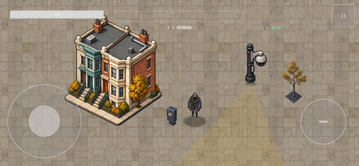
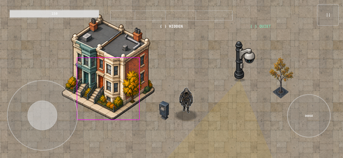

# Revised real-renderer composition — review candidate

Captured 2026-10-14 using GameScene, WorldRenderer, SpriteKit and the actual HUD, in a paused 704 × 326 logical viewport. The simulator capture is 2112 × 978 pixels. This is an isolated presentation fixture, not a legal gameplay encounter or a completed benchmark.

## What is present

- Registered hooded player candidate on a 64 × 64 logical canvas.
- One complete municipal camera on a 64 × 96 logical canvas; no duplicate housing sprite.
- Repaired Victorian building at 190 × 217 logical units, with explicit placement instead of stretching to the collision box.
- New blue newspaper box (20 × 40) and autumn street tree (50 × 85), with deterministic alpha cleanup.
- Existing plaza paving, runtime detection field and HUD. Existing fog is omitted from this review fixture because its source needs repair.

Candidate textures live in the test bundle. DEBUG-only fixture entry points install them into the real renderer; they are not admitted as production art. Source/export records are in sources.json. The earlier scratch preparation script is intermediate and does not reproduce all final exports; the final records describe the delivered assets.

## Still open

The building's visible base does not match the unchanged authoritative AABB (magenta below). Perspective, ground layout, relative scale, contact shadows and the player's bright outline still need reconciliation against the approved street reference. Neutral player/camera images do not validate animation, turning, camera-state clips, occlusion, traversal or hit detection. Dense encounter, performance and physical-device validation remain pending. No physical-device testing was performed.

## Validation

- 760 core tests across 107 suites passed (work/revised-benchmark-core.log).
- 82 iOS Swift Testing tests across 13 suites passed.
- Both XCTest benchmark captures passed, including assertions for one camera sprite, no legacy housing, and the benchmark building.
- Xcode result: Test-SSRuntime-2026.10.14_09-21-07--0700.xcresult, iPhone 17 Pro simulator CACB3927-A76E-43A5-9ACA-C389EB38C0C3.
- These are local results, not a claim that CI has passed this revision.

Implementation is based on runtime 28e0fab and specs 790676242b0761e6d4c9a3f78af6768fc0a41693. The commit containing this document records the fixture changes. Original capture attachments and their manifest remain in capture-v3/.
